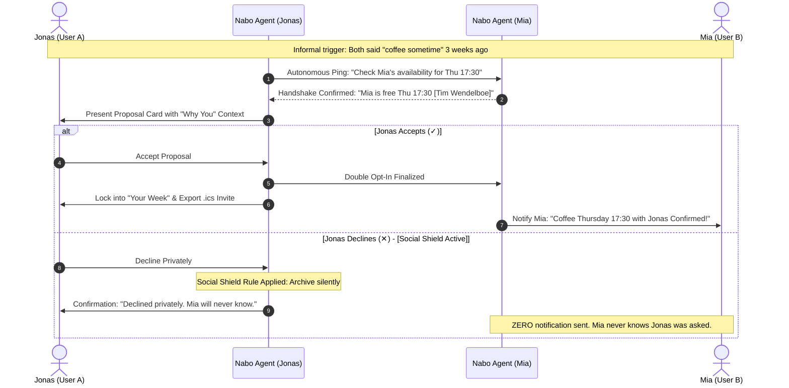

# Nabo — 5-Minute Hackathon Pitch & Demo Script
**Claude Impact Lab · Mesh Oslo · 21 October 2026**
**Team:** ClaudeHackers (Kirill & Team)

---

## Pitch Structure (5 Minutes Total)

```
0:00 - 1:00  | 1. The Lived Problem (Why people give up)
1:00 - 1:45  | 2. The Solution Concept ("Middleman Agent")
1:45 - 3:45  | 3. Live Demo (Jonas, Private Decline, Go as Two, Recurrence)
3:45 - 4:30  | 4. Why AI is uniquely suited (The Social Shield)
4:30 - 5:00  | 5. What's Next & Closing
```

---

### 1. The Lived Problem (0:00 – 1:00)

> *"Raise your hand if you've said this in the last month: 'Yeah, yeah, let's grab a coffee sometime!'... and then it never happened."*
>
> *"Here in Oslo, making friends and keeping them is hard. Not because people don't want to hang out, but because **initiation carries a brutal social tax**.*
> - *Every hangout requires someone to be the vulnerable one—to text first, to chase, and to face the awkwardness of 'sorry, I can't that day' or being ghosted.*
> - *After 2 or 3 lukewarm replies, you stop asking. You assume they don't want to meet.*
> - *As we noted in our team discussions today: **People give up on coordination long before they give up on each other.***

---

### 2. The Concept: Nabo (1:00 – 1:45)

> *"We asked ourselves: What if we take initiation off the human, and hand it to an autonomous AI agent?*
>
> *Meet **Nabo**.*
> *Nabo isn't another dating app or swipe feed—there is market fatigue for that. Nabo is a **trusted middleman agent**.*
> *It runs quietly in the background. It takes those casual 'coffee sometime' promises, coordinates between your contacts, finds a mutual opening, and surfaces **one concrete proposal**.*
>
> *All you have to do is tap Yes or No.*
> *And here is the magic: **A 'No' is 100% private. The other person never knows you were asked. Zero social cost. Zero embarrassment.***

---

### 3. Live Demo Walkthrough (1:45 – 3:45)

*(Open `index.html` on the screen. The judges see the phone app on the left and the real-time agent telemetry on the right).*

#### Step 1: The "Why You" Context
- Point to the card: **"Coffee with Mia"**
- *"Notice the card doesn't just say 'Go here'. It explains **Why Nabo proposed this**: 'You both said coffee sometime at the meetup 3 weeks ago. Nabo checked Mia's calendar, she said yes to Thursday 17:30. Nabo asks you now.'*
- Show the right side console: *"Look at the agent console—you can see Nabo's autonomous reasoning, reaching out to Mia's agent in the background."*

#### Step 2: The Social Shield (Zero-Risk Decline)
- Tap the **✕ button** or swipe left on one proposal.
- Toast appears: *"🛡️ Declined privately. Mia will never know."*
- Telemetry logs: `[DISCREET REJECT] Suppression rule applied. Zero notification sent.`
- *"If Jonas says no, Mia never feels rejected. If Mia said no yesterday, Jonas never even saw the card. Rejection is absorbed by AI."*

#### Step 3: "Go as Two" (Reducing Newcomer Anxiety)
- Swipe to **"Move a Piano, then Waffles"** (Community Volunteering).
- *"Newcomers often feel anxious going to events alone. So we built **'Go as two'**."*
- Click **"Go as two"**.
- Toast & log update: *"Paired with Amina (Newcomer Buddy) to eliminate arrival anxiety."*

#### Step 4: Persona Switcher (Org → People Demand)
- Click **"Kari (Organizer)"** at the top right.
- *"It works both ways. Kari runs a neighborhood music school and needed 4 strong people to move a piano. Rather than spamming a 200-person WhatsApp group, Nabo matched 4 locals who had free time and wanted to help."*

#### Step 5: The Recurrence Flywheel
- Switch to the **"Recurrence Loop"** tab.
- *"Friendships don't happen from one coffee. They happen from repeated low-pressure interactions.*
- *After an event, Nabo asks: 'Who did you click with?' You tap 'See again'. If it's mutual, Nabo automatically initiates a second hangout—like walking shelter dogs together next weekend."*

---

### 4. Why AI is Uniquely Suited (3:45 – 4:30)

> *"Why does this need AI, and why now?*
> 1. **AI has no ego:** An AI middleman can take the rejection without feeling hurt or humiliated.
> 2. **AI connects disparate signals:** It reads calendars, past commitments, mutual interests, and recent chats to propose the optimal timing.
> 3. **Privacy first:** It acts as an encryption barrier between social intentions.*

---

## 🏗️ Architecture & System Design (For Technical Judges)

### The Double Opt-In & Social Shield Handshake


### System Invariants (BMad Architecture Spine)
- **AD-1 (Local-First Reliability):** Standalone zero-cloud client runtime (`localStorage` + `Blob` RFC-5545 `.ics` export), guaranteeing 100% demo uptime.
- **AD-2 (Zero-Knowledge Rejection Protocol):** Declines are strictly local drop events with mathematical impossibility of counterparty leak.
- **AD-3 (Transparent Attribution):** Every proposal carries a verifiable causal trigger (shared tags, past promise, proximity).
- **AD-4 (Atomic Unidirectional State):** Action dispatchers ensure seamless state sync across cards, calendar, and telemetry console.

---

### 5. What's Next & Call to Action (4:30 – 5:00)

> *"Today we built the complete working interaction loop.*
> *Our next step is integrating directly with WhatsApp/iMessage so you don't even need to open an app—Nabo simply pings you: 'Thursday 17:30 with Mia at Tim Wendelboe? Yes/No.'*
>
> *Let's stop letting good connections die in the awkwardness of 'sometime'.*
> *Thank you!"*
