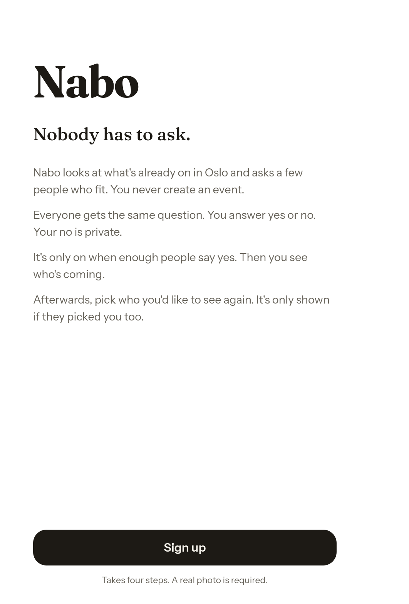
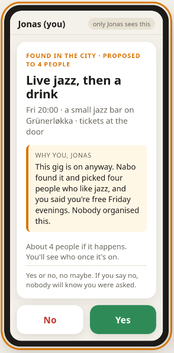
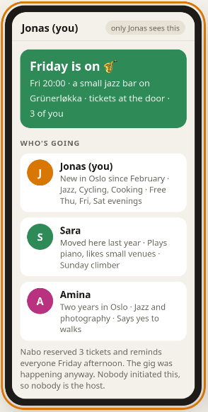

# Nabo — nobody has to ask

**Live app: <https://nabo-app-eta.vercel.app>**

https://github.com/user-attachments/assets/396393ea-8b78-4528-9a3e-1aee7701070a

Built at [Claude Impact Lab](https://www.gritai.studio/meetups/claude-impact-lab), Mesh Oslo, 21 October 2026. Area: *my community*.

## The problem

Someone who knows a few people in Oslo struggles to actually meet them, because every hangout depends on one person asking and coordinating. After a few "can't that day" replies they stop asking and assume nobody wants to.

## The idea

An agent does the asking. Nobody initiates, nobody is turned down in public, and nobody creates events: Nabo scans what is already happening in the city and sends people who fit to it, together.

- Same proposal to everyone at once, worded the same way
- Yes or no only, no maybe
- A no is private
- The plan is revealed only when enough said yes, then to everyone at once, with who's going
- After the event, pick who you'd like to see again; only mutual picks lead to a pair plan
- Effort is a filter: photo required, no-shows paused, serial decliners quietly ranked down

## Screenshots

| Sign up | The proposal | It's on |
|:-:|:-:|:-:|
|  |  |  |

## In this repo

- [`index.html`](index.html): the clickable prototype from the day. Open it in a browser, four phones side by side
- [`nabo-short.mp4`](nabo-short.mp4): demo video, to download
- [`DEMO.md`](DEMO.md): five-minute demo script
- [`initial_intent.md`](initial_intent.md): problem, idea, objections and decisions, in order
- [`ROADMAP.md`](ROADMAP.md): roadmap from prototype to pilot
- [`BRIEF.md`](BRIEF.md), [`CLAUDE.md`](CLAUDE.md): the event brief and instructions for Claude

All people in the prototype are made up.
