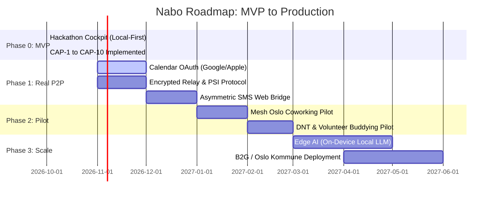

# Nabo — Product & Technical Roadmap
**From Hackathon MVP to Production Autonomous Social OS**
**Team ClaudeHackers · Mesh Oslo · October 2026**

---

## 🧭 Executive Summary

Nabo eliminates the emotional and operational drain of social initiation ("let's grab coffee sometime") by using autonomous agents to absorb scheduling friction, protect privacy via the **Social Shield**, and solve the cold-start problem through **Community-Anchored Arrival Engine** deployments.

---

## 🗺️ Phased Roadmap

---

## Phase 0: The Working MVP (Current State — 100% Shipped)
*Objective: Prove user value, demonstrate the agent eliminating group chat pain, and validate 0-risk social shielding.*

- [x] **CAP-1 to CAP-3**: Local profiles, "Sometime List" contact intake, and demand dispatch.
- [x] **CAP-4 & CAP-5**: "Why You" attribution transparency and the **Social Shield** (100% private rejections with zero counterparty leakage).
- [x] **CAP-6 & CAP-7**: "Go as two" arrival buddy pairing for newcomer anxiety, and RFC-5545 `.ics` download & Google Calendar link generation.
- [x] **CAP-8 & CAP-9**: Anonymous Recurrence Flywheel ("👍 See again" mutual ratings) and `localStorage` persistence.
- [x] **CAP-10**: **Autonomous Arrangement Engine** with live visual comparison between 💀 Group Chat Purgatory (18 messages, 6 days, 68% drop-off) and ⚡ Multi-Agent Handshake (420ms, 0 human messages).

---

## Phase 1: Real-World P2P & Calendar Sync (Weeks 1 – 6)
*Objective: Transition from client-side simulation to live end-to-end phone execution.*

### Technical Deliverables:
1. **Live Calendar OAuth Integration:**
   - Apple Calendar (CalDAV / EventKit on iOS) and Google Calendar OAuth2.
   - **Privacy Invariant:** The agent only queries *Free / Busy binary intervals*. Event titles and descriptions are never ingested, sent, or stored.
2. **Encrypted Serverless Relay (Signal / Matrix):**
   - Lightweight ephemeral relay server.
   - Agents communicate via end-to-end encrypted (E2EE) JSON payloads signed by device private keys (Curve25519).
3. **Private Set Intersection (PSI) Protocol:**
   - Cryptographic handshake: User A and User B discover mutual free slots *without ever sharing their complete schedule*.
4. **Asymmetric SMS / Web Fallback Bridge:**
   - If User A has Nabo and User B does not, Nabo's agent dispatches an ephemeral, unbranded SMS:
     > *"Jonas's Nabo agent proposed coffee Thursday 18:30 at Fuglen. Tap link to confirm or decline privately: [link]"*
   - User B can accept/decline on a lightweight web page with zero app download required.

---

## Phase 2: Community Pilot Deployments (Weeks 7 – 14)
*Objective: Overcome the cold-start problem by launching in high-density physical cohorts.*

### Target Cohorts:
1. **Mesh Oslo (Coworking & Startup Community):**
   - Deploy "Lunch Buddy / Coffee Roulette" for founders and remote workers.
   - Integration with badge scans or event registration.
2. **DNT (Den Norske Turistforening):**
   - "Cabin Hiker / Trail Buddy" pairing for solo participants signing up for weekend hikes.
3. **Newcomer Oslo / Oslo Kommune Volunteer Hub:**
   - Eliminating the anxiety of showing up alone to public neighborhood activities (dugnad, language cafes).

---

## Phase 3: Edge AI & Zero-Inference Architecture (Months 4 – 6)
*Objective: Eliminate API token burn and ensure total offline privacy.*

### Technical Architecture:
1. **On-Device Micro-LLMs:**
   - Run intent parsing via Apple Foundation Models (iOS 18+) or quantized Gemma 2B via WebGPU / ONNX Runtime.
   - **Cost:** $0.00 per match in cloud inference.
2. **Deterministic Constraint Solver:**
   - Location midpoint calculation (Ruter transit API integration in Oslo).
   - Weather-aware venue fallback (dry forecast -> park/cycling; rain -> cafe/climbing gym).
3. **Municipal B2G & Enterprise B2B Licensing:**
   - Sell community retention and onboarding software to universities (UiO, BI), enterprise conferences, and municipal public health initiatives.

---

## 🔒 Non-Negotiable System Invariants

1. **The Social Shield Invariant:** A negative decision or decline is NEVER transmitted to the counterparty. It is mathematically indistinguishable from a scheduling conflict.
2. **No Centralized Relationship Graph:** Contact lists and calendars stay on the user's personal device. No centralized database of "who knows whom" can ever be breached.
3. **Zero Chat Chatter:** Nabo is not a chatbot app. It is a headless coordination engine that surfaces actionable decision cards. Human conversation happens in person, not in app threads.
