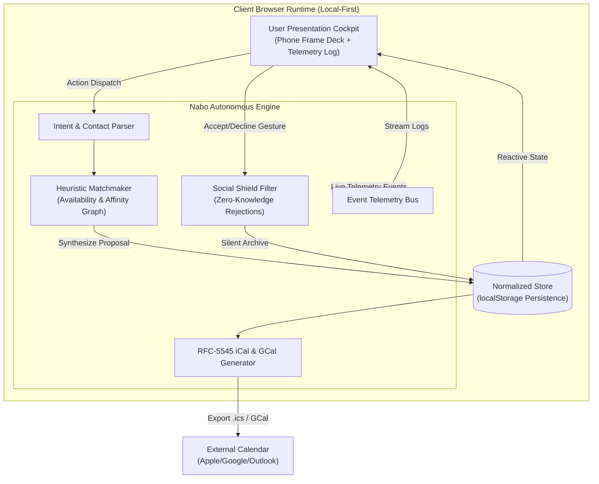
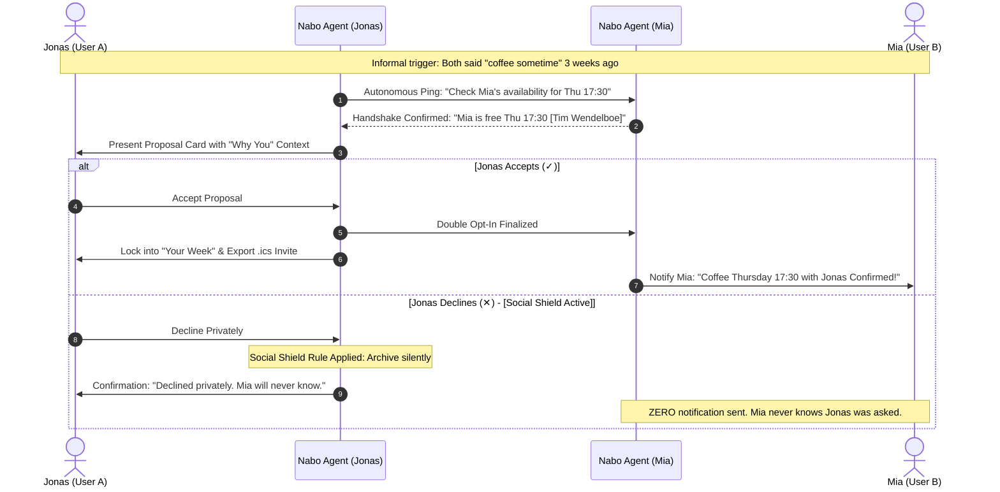

# Architecture Spine — Nabo Social Initiation Agent

## Design Paradigm

Nabo is designed as a **Local-First Autonomous Agent with Event-Driven Pub/Sub & Social Shielding**. Rather than requiring centralized cloud databases, user logins, or fragile external networking during live hackathon demonstrations, the system executes completely inside the browser runtime. The application decouples the **User Presentation Cockpit** from the **Autonomous Matchmaking Engine**, communicating through an atomic action-dispatch loop and emitting real-time telemetry events.

---

## Double Opt-In & Social Shield Sequence

This sequence illustrates the core architectural differentiator: **Rejections are absorbed by the agent; counterparties are never exposed to rejection.**

---

## Invariants & Rules

### AD-1 — Pure Client-Side Standalone Execution
- **Binds:** `all`
- **Prevents:** Dependency on external backends, database connections, or API keys that risk breaking during hackathon judging or offline projector setups.
- **Rule:** The MVP runs as a single self-contained application (`index.html`) using standard browser APIs (`localStorage`, `Blob`, `URL.createObjectURL`). No local server or build compilation step is required to run.

### AD-2 — Zero-Knowledge Rejection Protocol (The Social Shield)
- **Binds:** `CAP-5`
- **Prevents:** Social embarrassment, fear of rejection, and awkwardness between acquaintances.
- **Rule:** Any negative decision (`decline`, swipe left, dismiss) must be strictly local and confidential. The system is architecturally forbidden from emitting a rejection webhook, notification, or audit trail visible to the other party. The proposal is archived silently, and the audit log records a `SHIELDED DECLINE` event.

### AD-3 — Transparent Attribution Invariant ("Why You")
- **Binds:** `CAP-4`
- **Prevents:** Algorithmic opacity, swipe fatigue, and feelings of impersonal matchmaking.
- **Rule:** Every proposal synthesized by Nabo MUST include an explicit, human-readable `why` string detailing the origin trigger (e.g. mutual promise at a past meetup, shared interest tags, proximity, or community volunteer request).

### AD-4 — Atomic Unidirectional State Flow
- **Binds:** `CAP-1`, `CAP-2`, `CAP-3`, `CAP-9`
- **Prevents:** State desynchronization between proposal deck, schedule, recurrence feedback, and telemetry stream.
- **Rule:** State mutations occur strictly through defined action dispatchers (`handleCardDecision`, `submitIntake`, `toggleAffinity`). All state transitions write atomically to `localStorage` under `nabo_impact_lab_mvp_v3` and trigger reactive UI re-renders.

### AD-5 — RFC 5545 iCalendar Interoperability
- **Binds:** `CAP-7`
- **Prevents:** Calendar silos and manual date/time transcription.
- **Rule:** Confirmed hangouts must support one-click export into standard `.ics` format via in-memory Blobs, alongside direct URL templates for Google Calendar.

### AD-6 — Twin Persona Simulation Topology
- **Binds:** `CAP-1`, `CAP-3`
- **Prevents:** Requiring two distinct physical devices to demonstrate peer-to-peer and community organizer dynamics.
- **Rule:** The runtime maintains isolated profile states for **Jonas (Newcomer / P2P)** and **Kari (Community Organizer / Org-to-People)** with independent queues, allowing judges to toggle perspectives in 1 click while sharing the global agent telemetry bus.

---

## Consistency Conventions

| Concern | Convention |
| --- | --- |
| Identifiers | Prefixed kebab-case with timestamp: `prop-<timestamp>`, `sched-<timestamp>`, `past-<id>` |
| State Storage | Single key in `localStorage`: `nabo_impact_lab_mvp_v3` |
| Timestamps | ISO 8601 strings (`YYYY-MM-DDTHH:mm:ss.sssZ`) for machine records; HH:mm:ss for console logs |
| Error Handling | Non-blocking visual toasts with automatic 2.4s dismiss; errors logged to telemetry stream |
| Telemetry Formatting | Unified format: `{ time, tag, tagClass, text, isSpecial }` |

---

## Stack

| Name | Version / Spec | Role |
| --- | --- | --- |
| HTML5 / ES2022 | Living Standard | Core application structure and reactive logic |
| CSS3 (Vanilla) | Modern Spec | Design tokens, glassmorphism, responsive grid/flexbox |
| Web Storage API | `localStorage` | Client-side persistent state layer |
| Blob / File API | RFC 5545 | Dynamic `.ics` calendar generation |
| Plus Jakarta Sans | Google Fonts | Primary modern typography |
| JetBrains Mono | Google Fonts | Telemetry console & monospace data display |

---

## Deferred Items

- Live WhatsApp / SMS Twilio webhook adapters (deferred to Phase 2; simulated via telemetry console in MVP).
- End-to-end encrypted multi-device sync (deferred to post-hackathon production deployment).
